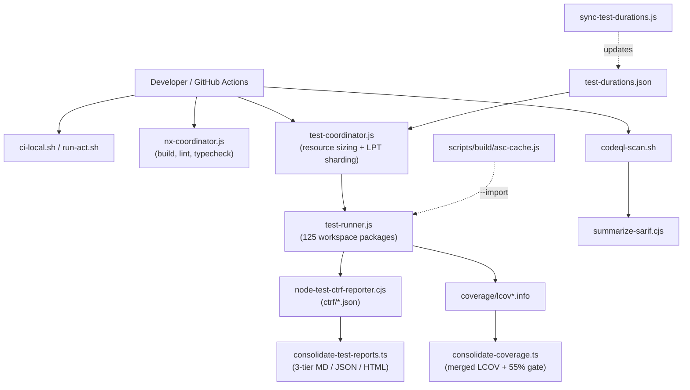

# `scripts/ci` — CI, Test, Build & Security Orchestration

This directory contains ModelScript's build/test coordinators, standardized package test runner, CTRF and LCOV report aggregators, local CI emulators, and CodeQL security scanning helpers.

## Architecture Overview

ModelScript's CI and local verification pipeline is organized into four layers:

1. **Resource-Aware Nx Orchestration (`nx-coordinator.js`, `test-coordinator.js`)**: Dynamically bounds parallelism from CPU cores and live available RAM (`/proc/meminfo` on Linux) so builds and tests do not OOM on laptops or GitHub runners.
2. **Balanced CI Sharding (`test-coordinator.js`, `test-durations.json`, `sync-test-durations.js`)**: Uses Longest Processing Time (LPT) bin-packing over empirical per-package durations to split tests evenly across the 12 CI shards.
3. **Standardized Package Execution (`test-runner.js`, `node-test-ctrf-reporter.cjs`)**: Invoked by 125 workspace `package.json` manifests (enforced by `scripts/lint/lint-package-manifests.ts`) to run `tsx --test` with AssemblyScript WASM caching, CTRF JSON output, and repo-relative LCOV coverage.
4. **Consolidation, Local CI & Security (`consolidate-test-reports.ts`, `consolidate-coverage.ts`, `ci-local.sh`, `run-act.sh`, `codeql-scan.sh`, `summarize-sarif.cjs`)**: Merges sharded outputs into GitHub step summaries and interactive HTML dashboards, emulates CI locally, and runs CodeQL scans.

## Quick Reference

| File                                                           | npm Script(s)                                                                                                           | When to Use                                                                                   |
| -------------------------------------------------------------- | ----------------------------------------------------------------------------------------------------------------------- | --------------------------------------------------------------------------------------------- |
| [`nx-coordinator.js`](./nx-coordinator.js)                     | `build`, `build:affected`, `build:libs`, `lint`, `lint:all`, `typecheck`, `typecheck:all`, `verify:all`, `verify:fresh` | Automatically invoked for non-test Nx targets to size `--parallel` safely.                    |
| [`test-coordinator.js`](./test-coordinator.js)                 | `test`, `test:all`, `test:fast`, `test:compiler`, `test:platform`                                                       | Running unit tests across affected/all packages locally or sharded in CI (`--shard=K/N`).     |
| [`test-durations.json`](./test-durations.json)                 | _(data file)_                                                                                                           | Empirical per-package test durations (seconds) used for CI shard balancing.                   |
| [`sync-test-durations.js`](./sync-test-durations.js)           | `test:durations:sync`                                                                                                   | Refresh `test-durations.json` after full test runs or downloaded CI CTRF artifacts.           |
| [`test-coordinator.test.mjs`](./test-coordinator.test.mjs)     | `node scripts/ci/test-coordinator.test.mjs`                                                                             | Verify allocation math and shard bin-packing after editing `test-coordinator.js`.             |
| [`test-runner.js`](./test-runner.js)                           | Per-workspace `test` / `test:unit`                                                                                      | Standard per-package test runner wrapping `tsx --test`, CTRF, LCOV, and WASM cache.           |
| [`node-test-ctrf-reporter.cjs`](./node-test-ctrf-reporter.cjs) | _(loaded by `test-runner.js`)_                                                                                          | Converts `node:test` streams into CTRF JSON with suite-failure attribution.                   |
| [`consolidate-test-reports.ts`](./consolidate-test-reports.ts) | `test:consolidate`                                                                                                      | Merge unit, OMC, and MSL CTRF JSON reports into Markdown, JSON, and HTML.                     |
| [`consolidate-coverage.ts`](./consolidate-coverage.ts)         | `coverage:consolidate`                                                                                                  | Merge LCOV files across shards, attribute to owning packages, and enforce coverage threshold. |
| [`ci-local.sh`](./ci-local.sh)                                 | `ci:local`, `ci:quick`, `ci:full`                                                                                       | Run the CI pipeline natively on your machine before pushing.                                  |
| [`run-act.sh`](./run-act.sh)                                   | `ci:act`, `ci:act:lint`, `ci:act:test`, `ci:act:build`, `ci:act:modelica`                                               | Run `.github/workflows/ci.yml` inside Docker containers via `nektos/act`.                     |
| [`codeql-scan.sh`](./codeql-scan.sh)                           | `codeql`, `codeql:docker`, `codeql:install`                                                                             | Run CodeQL security analysis locally or via Docker.                                           |
| [`summarize-sarif.cjs`](./summarize-sarif.cjs)                 | _(called by `codeql-scan.sh`)_                                                                                          | Pretty-print SARIF 2.1.0 security alerts and exit non-zero on findings.                       |

---

## Script Reference

### [`nx-coordinator.js`](./nx-coordinator.js)

- **Purpose:** Dynamic memory- and CPU-aware wrapper around the Nx CLI for `build`, `lint`, and `typecheck` targets.
- **When to use:** Used automatically by root `package.json` scripts (`npm run build`, `npm run lint`, `npm run typecheck`, `npm run verify:fresh`) and `ci-local.sh`. Run directly if you want custom Nx arguments with safe parallelism.
- **How it works:**
  - Reads available memory from `/proc/meminfo` (`MemAvailable`) on Linux or `os.freemem()` elsewhere, reserving `clamp(availMem * 0.2, 1.5 GB, 3.0 GB)` for the OS.
  - Estimates per-worker RAM by target: `400 MB` for `lint`, `250 MB` for `typecheck`-only, and `300 MB` for `build`/default.
  - Computes `optimal = clamp(floor((availMem - reserve) / perWorkerBytes), 1, cpus)` unless overridden.
  - Forces `NX_TUI=false` and `--output-style=stream` in non-interactive or CI environments and forwards `SIGINT`/`SIGTERM` cleanly.
- **CLI flags & environment variables:**
  - Accepts any Nx arguments (`run-many`, `affected`, `--target=...`, `--projects=...`, `--parallel=N`).
  - `NX_PARALLEL`: Explicitly overrides computed `--parallel`.
  - `CI`, `CONTINUOUS_INTEGRATION`, `GITHUB_ACTIONS`, `NX_TUI`: Control streaming vs. TUI mode.
- **Outputs & exit codes:** Prints an `[nx-coordinator]` allocation banner, streams Nx stdout/stderr, and exits with the child Nx exit code (or re-raises its signal).
- **Callers:** Root `package.json` (`build`, `build:affected`, `build:extension`, `build:libs`, `lint`, `lint:all`, `typecheck`, `typecheck:all`, `verify:all`, `verify:fresh`) and `scripts/ci/ci-local.sh`.

---

### [`test-coordinator.js`](./test-coordinator.js)

- **Purpose:** Two-tier resource allocator and LPT shard balancer for running package `test` targets through Nx.
- **When to use:** Automatically invoked by `npm test`, `npm run test:all`, `ci-local.sh`, and the 12-shard `test` matrix in `.github/workflows/ci.yml`.
- **How it works:**
  - **Two-tier budgeting (`computeOptimalAllocation`):** Assumes `750 MB` per `tsx` + V8 + WASM test worker and reserves `clamp(freeMem * 0.15, 500 MB, 2 GB)`. Splits the total worker budget into Nx concurrent packages `P` (`--parallel`) and per-package `node:test` workers `W` (`TEST_CONCURRENCY`) such that `P * W <= totalBudget` (single-package runs use `P = 1, W = min(totalBudget, 12)`).
  - **LPT shard bin-packing (`partitionProjectsIntoShards`):** When `--shard=K/N` is passed, looks up each project's duration in [`test-durations.json`](./test-durations.json) (falling back to `4s * testFileCount`), sorts heaviest-first, and greedily assigns projects to the lightest shard. Rewrites the Nx invocation to `run-many --projects=<shardProjects>`.
  - Injects `NODE_ENV=test`, `NX_TUI=false`, `TEST_CONCURRENCY`, `SHARD_HANDLED_BY_COORDINATOR=1`, and defaults `NODE_OPTIONS` to `--max-old-space-size=2048`.
- **CLI flags & environment variables:**
  - Mode: `affected` (default) or `run-many`.
  - `--shard=K/N` (or `--shard K/N`): Run shard `K` of `N`.
  - `--parallel=P`, `--concurrency=W` / `--test-concurrency=W`: Override `P` and/or `W`.
  - `--dry-run`: Print shard assignment and JSON allocation without executing tests.
  - Pass-through Nx flags: `--projects=`, `-p=`, `--base=`, `--head=`, `--exclude=`, `--output-style=`.
  - Env vars: `TEST_PARALLEL_TASKS`, `TEST_CONCURRENCY`, `NX_BASE`, `NX_HEAD`, `NODE_ENV`, `NODE_OPTIONS`.
- **Exit codes:** `0` on success, empty shard, or `--dry-run`; `1` on invalid `--shard` syntax; otherwise mirrors the Nx exit code.
- **Callers:** `.github/workflows/ci.yml` (`test` matrix shards `1..12`), root `package.json` (`test`, `test:all`, `test:fast`, `test:compiler`, `test:platform`), `ci-local.sh`. Exported helpers are also imported by `test-runner.js` and `test-coordinator.test.mjs`.

---

### [`test-durations.json`](./test-durations.json) & [`sync-test-durations.js`](./sync-test-durations.js)

- **Purpose:** `test-durations.json` stores empirical test runtimes (in seconds, 1 decimal place) for workspace packages so `test-coordinator.js` can balance heavy packages (such as `@modelscript/runtime` and `@modelscript/olga`) across CI shards. `sync-test-durations.js` updates this file from CTRF reports.
- **When to use:** Run `npm run test:durations:sync` after a full local test run or after downloading CI `ctrf-*` artifacts into `ctrf-artifacts/` when shard runtimes drift out of balance.
- **How `sync-test-durations.js` works:**
  - Scans `--dir=<path>` (or the first existing directory among `ctrf-artifacts/`, `.cache/ci-artifacts/`, and the repo root) for `ctrf-report.json` and `ctrf-modelscript-*.json`.
  - Computes `(summary.stop - summary.start) / 1000`, resolves the owning package name, merges into `test-durations.json` (preserving unmeasured packages), and writes alphabetically sorted JSON.
- **CLI flags:** `--dir=<path>`.
- **Callers:** Root `package.json` (`test:durations:sync`); `test-durations.json` is read by `test-coordinator.js`.

---

### [`test-coordinator.test.mjs`](./test-coordinator.test.mjs)

- **Purpose:** Standalone Node ESM unit tests (using `node:assert`) for `computeOptimalAllocation` and `partitionProjectsIntoShards` in `test-coordinator.js`.
- **When to use:** Run manually (`node scripts/ci/test-coordinator.test.mjs`) after changing resource budgeting or shard-balancing logic in `test-coordinator.js`.
- **Coverage:** Verifies 16-core, memory-constrained, 8-core, 4-core, single-package cap (`workers <= 12`), explicit user overrides, and 4-shard LPT balance/disjointness invariants.

---

### [`test-runner.js`](./test-runner.js)

- **Purpose:** Universal per-package test execution wrapper invoked by 125 workspace `package.json` manifests (`packages/*`, `languages/*`, `apps/*`, `ee/`). Enforced across the monorepo by `scripts/lint/lint-package-manifests.ts` (`standard-test-runner`).
- **When to use:** Automatically invoked whenever you run `npm test` inside a workspace package or via Nx. Use directly to pass extra flags like `--coverage`, `--no-coverage`, `--timeout=...`, or specific test file paths.
- **How it works:**
  - Prepends `--import scripts/build/asc-cache.js` (when present) to cache compiled AssemblyScript WASM parsers in `.cache/asc-tests/`.
  - Auto-detects `./tests/test-setup.ts` and `tests/tsconfig.json` / `validation/tsconfig.json`, and auto-discovers `tests/**/*.test.ts` or `validation/**/*.test.ts` when no positional files are passed.
  - Absorbs Nx pass-through flags (`--shard`, `--parallel`, `--projects`, `--base`, `--head`, etc.) so `tsx`/`node:test` never fail on Nx CLI arguments.
  - Respects `TEST_CONCURRENCY` set by `test-coordinator.js` (ignoring local `--concurrency` overrides when coordinated) or computes a single-package worker count automatically.
  - Runs `tsx --test` with both the terminal `spec` reporter and [`node-test-ctrf-reporter.cjs`](./node-test-ctrf-reporter.cjs).
  - When coverage is enabled (`CI`, `COVERAGE=true`, `TEST_COVERAGE=true`, or `--coverage`), enables `--experimental-test-coverage`, excludes generated/test dirs, rewrites LCOV `SF:` paths to repo-relative POSIX paths, and emits both `coverage/lcov.info` and `coverage/lcov-<pkgSafeName>.info`.
- **CLI flags & environment variables:**
  - `--coverage` / `--experimental-test-coverage`, `--no-coverage`
  - `--timeout=<ms>` / `--test-timeout=<ms>` (default `60000`)
  - `--concurrency=<n>` / `--test-concurrency=<n>`
  - `--import=<file>`, `--tsconfig=<file>`, `--lcov=<path>` (default `coverage/lcov.info`)
  - Env vars: `NODE_ENV`, `CI`, `COVERAGE`, `TEST_COVERAGE`, `TEST_CONCURRENCY`, `CONCURRENCY`, `TEST_TIMEOUT`, `TSX_TSCONFIG_PATH`.
- **Exit codes:** Mirrors the `tsx --test` exit code (`1` on unexpected spawn error).

---

### [`node-test-ctrf-reporter.cjs`](./node-test-ctrf-reporter.cjs)

- **Purpose:** Zero-dependency CommonJS async-generator reporter for Node's native `node:test` runner (`--test-reporter`) that writes standard CTRF JSON reports.
- **When to use:** Loaded automatically by `test-runner.js`. You only interact with it when debugging CTRF output or setting `CTRF_OUTPUT_DIR` / `CTRF_OUTPUT_PATH`.
- **How it works:**
  - Tracks nested suites (`"Suite > Subsuite"`) and records test pass/fail/skip/pending status, duration, relative file path, and error stack traces.
  - Captures suite-level setup/teardown failures and retroactively attaches the parent suite error to cancelled child tests (or synthesizes a `"(suite setup)"` entry if no children ran).
  - Yields nothing to stdout so `spec` owns terminal output cleanly.
- **Environment variables & outputs:**
  - `CTRF_OUTPUT_DIR` (default `<cwd>/ctrf`), `CTRF_OUTPUT_PATH` (default `<outputDir>/ctrf-report.json`).
  - Also writes `<outputDir>/ctrf-<pkgSafeName>.json` for collision-free artifact uploads in CI.

---

### [`consolidate-test-reports.ts`](./consolidate-test-reports.ts)

- **Purpose:** Aggregates CTRF JSON reports from all workspace unit tests, Modelica OpenModelica (OMC) conformance tests, and MSL verification benchmarks into a unified 3-tier report.
- **When to use:** Runs in GitHub Actions' `publish_reports` job, at the end of `ci-local.sh`, or locally via `npm run test:consolidate` to generate an interactive HTML test dashboard.
- **How it works:**
  - Recursively discovers `*.json` CTRF files (deduplicating combined vs. per-backend testsuite reports).
  - Classifies tests into three tiers:
    - **Tier 1 (`unit`):** Package unit tests grouped by `@modelscript/*` package.
    - **Tier 2 (`omc`):** OpenModelica conformance suite with WASM vs. JS dual-backend parity tracking.
    - **Tier 3 (`msl`):** Modelica Standard Library verification grouped by stage (`flatten`, `simulate`, `diagram`, `icon`).
  - Treats `xfail`, `xpass`, and `tolerated` entries as expected so they do not trip the failure gate.
  - Emits Markdown, consolidated CTRF JSON, and a self-contained dark-mode HTML dashboard with live search and Tier/Status/Backend filters.
- **CLI flags & environment variables:**
  - `--dir=<path>` (defaults to `ctrf-artifacts/` if present, else `cwd`), `--output-json=<path>`, `--output-html=<path>`, `--output-md=<path>`, `--github-step-summary`, `--check-failed`, `--silent`.
  - Env vars: `GITHUB_STEP_SUMMARY`, `GITHUB_OUTPUT` (`total_tests`, `has_failure`).
- **Exit codes:** `0` normally; `1` if `--check-failed` is set and any non-xfail test failed.

---

### [`consolidate-coverage.ts`](./consolidate-coverage.ts)

- **Purpose:** Merges LCOV coverage files from all unit test shards and OMC `c8` runs into a single consolidated LCOV file, JSON summary, and Markdown breakdown, enforcing a minimum line-coverage threshold.
- **When to use:** Runs in GitHub Actions' `publish_reports` job (with `--threshold=55`), at the end of `ci-local.sh`, or locally via `npm run coverage:consolidate`.
- **How it works:**
  - Discovers `*lcov*.info` and `*.lcov` files while skipping generic `lcov.info` when a package-named `lcov-*.info` exists in the same directory.
  - Normalizes `SF:` paths to repo-relative paths, strips non-source files (`dist/`, `tests/`, `src-gen/`, `as-gen/`, etc.), and re-attributes cross-package coverage to each file's owning `@modelscript/*` package.
  - Deduplicates records by taking `Math.max` per metric.
- **CLI flags & environment variables:**
  - `--dir=<path>`, `--output-lcov=<path>` (default `coverage/lcov-consolidated.info`), `--output-json=<path>` (default `coverage/coverage-summary.json`), `--output-md=<path>`, `--threshold=<pct>`, `--github-step-summary`, `--silent`.
  - Env vars: `GITHUB_STEP_SUMMARY`, `GITHUB_OUTPUT`.
- **Exit codes:** `0` normally; `1` if `--threshold` is set and overall line coverage is below `<pct>`.

---

### [`ci-local.sh`](./ci-local.sh)

- **Purpose:** Native bash runner that reproduces the core GitHub Actions CI pipeline locally without Docker overhead.
- **When to use:** Run `npm run ci:quick` (lint + affected tests) before opening a PR, or `npm run ci:full` (lint + all tests + exchange validation + build + VS Code extension packaging) before cutting a release.
- **How it works:**
  - Sets `NX_TUI=false` and `CI=true`, and auto-detects `--base` (`HEAD~1` on `main`/`master`, else `origin/main` / `main`).
  - **Lint stage:** `lint:repo`, `lint:scripts`, `@modelscript/docs` check, `tsc --noEmit`, and Nx `lint` + `typecheck` via `nx-coordinator.js`.
  - **Test stage:** Ensures MSL archive is present (`scripts/build/download-msl.cjs`), runs `test-coordinator.js`, and consolidates CTRF + coverage reports (`ctrf/test-report-unified.html`). In `--full` mode, also runs `@modelscript/exchange` validation and `test:fmusim`.
  - **Build stage:** Runs Nx `build` via `nx-coordinator.js`; in `--full` mode, also builds and packages the VS Code `.vsix` extension.
- **CLI flags:** `--quick` (default), `--lint`, `--test`, `--build`, `--full`, `--all`, `--base <ref>`, `-h` / `--help`.
- **Callers:** Root `package.json` (`ci:local`, `ci:quick`, `ci:full`).

---

### [`run-act.sh`](./run-act.sh)

- **Purpose:** Executes `.github/workflows/ci.yml` locally inside Docker containers using `nektos/act`.
- **When to use:** When debugging GitHub Actions workflow YAML, step conditionals, or Ubuntu runner differences that `ci-local.sh` does not cover.
- **How it works:**
  - Defaults to the `pull_request` event with `.github/act-event.json`, `.github/workflows/ci.yml`, and `--artifact-server-path .cache/act-artifacts`.
  - Automatically selects the first available runner: host `act`, `gh act` extension, or Docker `nektos/act:latest` mounting `/var/run/docker.sock`.
- **CLI flags:** Forwards all arguments directly to `act` (e.g., `-j lint`, `-j test`, `-W <workflow>`).
- **Callers:** Root `package.json` (`ci:act`, `ci:act:lint`, `ci:act:test`, `ci:act:build`, `ci:act:modelica`).

---

### [`codeql-scan.sh`](./codeql-scan.sh) & [`summarize-sarif.cjs`](./summarize-sarif.cjs)

- **Purpose:** `codeql-scan.sh` runs GitHub CodeQL static security analysis locally (host CLI or Docker) using `.github/codeql/codeql-config.yml`; `summarize-sarif.cjs` parses the resulting SARIF 2.1.0 JSON and prints colorized alerts.
- **When to use:** Use `npm run codeql` (or `npm run codeql:install` once on Linux, or `npm run codeql:docker` to avoid local installation) to reproduce and verify CodeQL security alerts locally before pushing.
- **CLI flags (`codeql-scan.sh`):**
  - `--docker`: Run inside `mcr.microsoft.com/cstsectools/codeql-container:latest`.
  - `--install`: Auto-download `codeql-bundle-linux64.tar.gz` into `.cache/codeql/`.
  - `--db <path>` (default `.cache/codeql-db`), `--output <file>` (default `.cache/codeql-results.sarif`), `--suite <suite>` (default `javascript-security-extended.qls`), `--language <lang>` (default `javascript-typescript`), `-h` / `--help`.
- **Exit codes:** `0` when 0 alerts are found; `1` on CLI/Docker errors or when `summarize-sarif.cjs` detects security alerts or malformed SARIF.
- **Callers:** Root `package.json` (`codeql`, `codeql:docker`, `codeql:install`).
