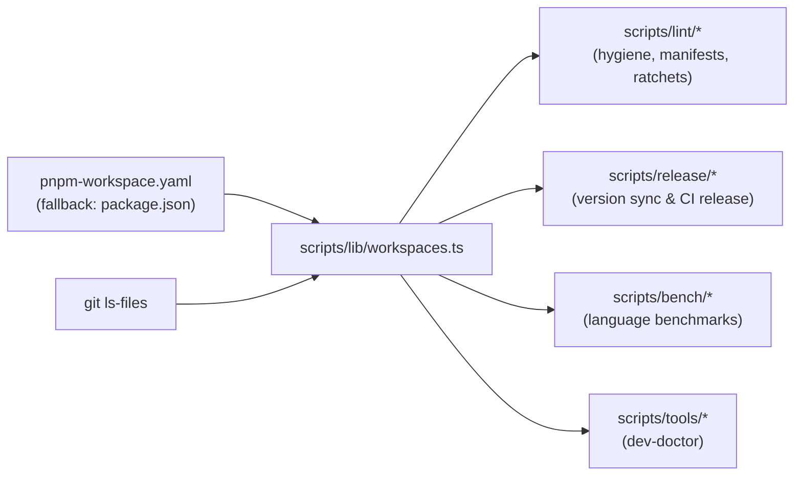

# `scripts/lib` — Shared Script Libraries

This directory contains shared TypeScript helper modules imported across ModelScript's repository automation (`scripts/lint/`, `scripts/release/`, `scripts/bench/`, and `scripts/tools/`). Keeping workspace discovery, git file enumeration, and canonical exclusion patterns here ensures every script agrees on which packages and files belong to the monorepo.

## Architecture Role

## Quick Reference

| File                               | Purpose                                                                                     | Primary Consumers                                                           |
| ---------------------------------- | ------------------------------------------------------------------------------------------- | --------------------------------------------------------------------------- |
| [`workspaces.ts`](./workspaces.ts) | Monorepo workspace discovery, `REPO_ROOT`, tracked-file listing, and shared path exclusions | `scripts/lint/*`, `scripts/release/*`, `scripts/bench/*`, `scripts/tools/*` |

---

## [`workspaces.ts`](./workspaces.ts)

### Purpose

Provides a single source of truth for resolving the repository root, discovering workspace packages, listing git-tracked files, and filtering out generated, vendored, or scratch paths.

### When to Use

Import from `scripts/lib/workspaces.ts` whenever writing or updating a repository script that needs to:

- Iterate over all workspace `package.json` manifests or workspace directories (instead of hardcoding `packages/*` or `languages/*`).
- Walk git-tracked source files without duplicating `git ls-files` shell invocations.
- Exclude generated outputs (`dist/`, `src-gen/`, `as-gen/`, `*.d.ts`), vendored files, or OpenModelica testsuite fixtures consistently with repo-wide lints.

### Exported API

| Export                           | Kind                | Description                                                                                                                                                                                                                                                                     |
| -------------------------------- | ------------------- | ------------------------------------------------------------------------------------------------------------------------------------------------------------------------------------------------------------------------------------------------------------------------------- |
| `REPO_ROOT`                      | `string`            | Absolute path to the repository root (`path.resolve(__dirname, "../..")`).                                                                                                                                                                                                      |
| `EXCLUDED_REPO_PATTERNS`         | `readonly RegExp[]` | Canonical exclusion list covering `languages/modelica/testsuite/`, `src-gen/`, `as-gen/`, `dist/`, `build/`, `node_modules/`, `vendor/`, `*.d.ts`, `scratch*`, `.agents/`, `.gemini/`, and `.react-router/`.                                                                    |
| `WorkspaceDiscoveryOptions`      | `interface`         | Options for workspace discovery: `{ excludeExamples?: boolean; excludeIdeGithubFs?: boolean; rootDir?: string }`.                                                                                                                                                               |
| `shouldExcludeRepoPath(relPath)` | `function`          | Normalizes Windows backslashes to POSIX `/` and returns `true` if `relPath` matches any pattern in `EXCLUDED_REPO_PATTERNS`.                                                                                                                                                    |
| `getWorkspacePackages(options?)` | `function`          | Parses `pnpm-workspace.yaml` (falling back to `package.json#workspaces`), expands `/*` directory globs and exact workspace paths, filters optional exclusions (`packages/examples*`, `apps/ide/github-fs`), and returns sorted absolute paths to existing `package.json` files. |
| `getWorkspaceDirs(options?)`     | `function`          | Maps `getWorkspacePackages(options)` to sorted, POSIX-normalized relative directory paths (e.g., `packages/runtime`).                                                                                                                                                           |
| `getTrackedFiles(forceRefresh?)` | `function`          | Runs `git ls-files` synchronously in `REPO_ROOT` and memoizes the result for the process lifetime unless `forceRefresh` is `true`.                                                                                                                                              |

### Inputs, Outputs, and Side Effects

- **Inputs:** `pnpm-workspace.yaml` (or root `package.json`), filesystem directory layout, and `git ls-files` output.
- **Outputs:** Pure return values (`string[]`, `boolean`). No files are written.
- **Side effects:** Spawns `git ls-files` once per process (cached in module state) when `getTrackedFiles()` is called.
- **Error behavior:** Library module (no CLI entry point); throws if `package.json` cannot be read or `git ls-files` fails.

### Callers

- **Lint & hygiene (`scripts/lint/`):** `repo-doctor.ts`, `repo-hygiene.test.mjs`, `lint-package-manifests.ts`, `verify-dist-integrity.ts`, `verify-pack-install.ts`, `lint-filenames.ts`, `normalize-headers.ts`, `lint-type-safety-ratchet.ts`, `audit-language-maturity.ts`, `lint-lockfile.ts`.
- **Release (`scripts/release/`):** `sync-versions.ts`, `ci-release-version.ts`.
- **Benchmarks & tools:** `scripts/bench/benchmark-languages.ts`, `scripts/tools/dev-doctor.ts`.
