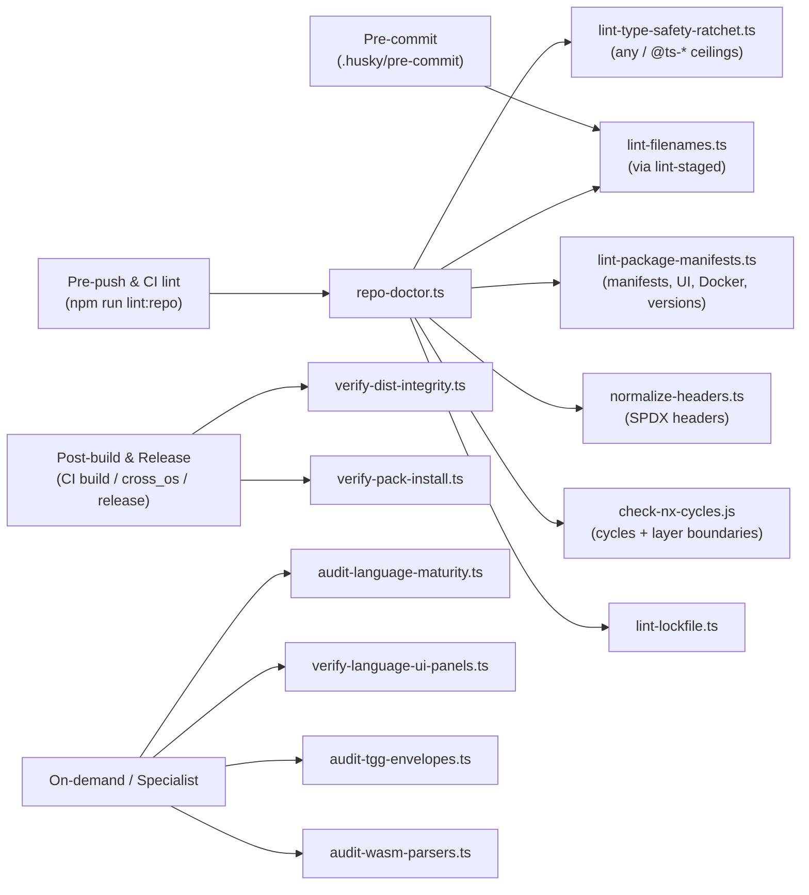

# `scripts/lint` — Repository Hygiene, Governance & Integrity Audits

This directory contains ModelScript's structural linters, architectural boundary guards, type-safety ratchet, post-build artifact verifiers, and polyglot maturity audits.

## Governance Architecture

ModelScript enforces repository quality across four checkpoints:

## Quick Reference

| File                                                             | npm Script                                    | Gate / Stage                                           | What It Checks                                                                                                                              |
| ---------------------------------------------------------------- | --------------------------------------------- | ------------------------------------------------------ | ------------------------------------------------------------------------------------------------------------------------------------------- |
| [`repo-doctor.ts`](./repo-doctor.ts)                             | `lint:repo`                                   | Pre-push, CI `lint`, `ci-local.sh`                     | Runs all 6 structural hygiene checks in one process (and `--fix` auto-syncs manifests/headers/versions).                                    |
| [`lint-lockfile.ts`](./lint-lockfile.ts)                         | `lint:lockfile`                               | `repo-doctor`                                          | Verifies `pnpm-lock.yaml` (or `package-lock.json`) is in sync with manifests and cleanly staged in Git.                                     |
| [`check-nx-cycles.js`](./check-nx-cycles.js)                     | `lint:cycles`                                 | `repo-doctor`                                          | Detects circular Nx project dependencies and enforces open-core / engine-vs-app / EE layer boundaries.                                      |
| [`normalize-headers.ts`](./normalize-headers.ts)                 | `lint:headers`                                | `repo-doctor`                                          | Enforces `AGPL-3.0-or-later` vs. `LicenseRef-ModelScript-Enterprise` SPDX headers on all tracked source/script files.                       |
| [`lint-filenames.ts`](./lint-filenames.ts)                       | `lint:filenames`                              | Pre-commit (`lint-staged`), `repo-doctor`, cross-OS CI | Enforces cross-OS filename conventions (PascalCase web components, kebab-case IDE/LSP files, no `test-*.test.ts`).                          |
| [`lint-package-manifests.ts`](./lint-package-manifests.ts)       | `lint:manifests`                              | `repo-doctor`, cross-OS CI, release                    | Audits workspace `package.json`, `README.md`, `Dockerfile`, `tsconfig.json` paths, UI boundaries, and version sync.                         |
| [`lint-type-safety-ratchet.ts`](./lint-type-safety-ratchet.ts)   | `lint:types-ratchet`                          | `repo-doctor`, cross-OS CI                             | Prevents regressions in explicit `any` and `@ts-ignore`/`@ts-expect-error`/`@ts-nocheck` counts against `config/type-safety-baseline.json`. |
| [`verify-dist-integrity.ts`](./verify-dist-integrity.ts)         | `verify:dist`                                 | Pre-push, CI `build`, cross-OS, release                | Verifies every `./dist/...` export exists & is non-empty, and `.wasm` / `src-gen/bindings.js` assets are copied to `dist/`.                 |
| [`verify-pack-install.ts`](./verify-pack-install.ts)             | `verify:pack`                                 | CI `build`, cross-OS, nightly                          | Checks `package.json#files` whitelists, stale `pnpm.overrides`, `npm pack --dry-run`, and live ESM imports of core SDKs.                    |
| [`audit-language-maturity.ts`](./audit-language-maturity.ts)     | `audit:languages`                             | On-demand / `benchmark-languages.ts`                   | Audits all languages against the 6-pillar maturity rubric (`beta` / `alpha` / `pre-alpha`).                                                 |
| [`verify-language-ui-panels.ts`](./verify-language-ui-panels.ts) | `verify:language-ui`                          | On-demand                                              | Compiles every declared language `ui.panels` and `ui.simulationCards` entry via headless Vite transform.                                    |
| [`audit-tgg-envelopes.ts`](./audit-tgg-envelopes.ts)             | `npx tsx scripts/lint/audit-tgg-envelopes.ts` | On-demand                                              | Inventories dedicated TGG vs. inline polyglot vs. missing TGG coverage across `languages/*`.                                                |
| [`audit-wasm-parsers.ts`](./audit-wasm-parsers.ts)               | `npx tsx scripts/lint/audit-wasm-parsers.ts`  | On-demand (post-build)                                 | Verifies every language has a built `parser.wasm` and that LSP validation has no regex fallback.                                            |
| [`repo-hygiene.test.mjs`](./repo-hygiene.test.mjs)               | `npx tsx scripts/lint/repo-hygiene.test.mjs`  | Manual self-test                                       | Unit and smoke tests for the `scripts/lint/` and `scripts/lib/workspaces.ts` toolkit itself.                                                |

---

## Script Reference

### [`repo-doctor.ts`](./repo-doctor.ts)

- **Purpose:** Unified repository hygiene orchestrator that runs 6 structural checks in a single process (sharing `getWorkspacePackages()` and `getTrackedFiles()` caches), parallelizing the 2 child-process checks (`lockfile`, `cycles`) alongside the 4 in-process checks (`headers`, `filenames`, `manifests`, `types-ratchet`).
- **When to use:** Run `npm run lint:repo` before pushing (also enforced by `.husky/pre-push`, `ci-local.sh`, and CI's `lint` job). Run `npx tsx scripts/lint/repo-doctor.ts --fix` to auto-repair maturity metadata, shared `devDependencies`, `Dockerfile` manifest `COPY` lines, monorepo version pins, and SPDX headers.
- **CLI flags:** `--skip-lockfile`, `--skip-cycles`, `--fix` / `--sync`.
- **Exit codes:** `0` if all checks pass, `1` if any check fails.

---

### [`lint-lockfile.ts`](./lint-lockfile.ts)

- **Purpose:** Ensures `pnpm-lock.yaml` (or `package-lock.json`) matches all workspace manifests and is never left partially staged or unstaged when `package.json` / `pnpm-workspace.yaml` changes are staged.
- **When to use:** Automatically via `lint:repo`, or standalone via `npm run lint:lockfile` after adding/updating dependencies.
- **How it works:** Inspects `git diff --cached` and `git status --porcelain`, then runs `pnpm install --frozen-lockfile --ignore-scripts --lockfile-only` (or `npm ci --dry-run --ignore-scripts`). Read-only.
- **Exit codes:** `0` when synchronized and cleanly staged, `1` on drift or staging violation.

---

### [`check-nx-cycles.js`](./check-nx-cycles.js)

- **Purpose:** Guards monorepo DAG acyclicity and architectural layer boundaries using the Nx project graph.
- **When to use:** Runs as part of `lint:repo` (which enforces both cycles and boundary violations) or standalone via `npm run lint:cycles`.
- **Enforced invariants:**
  1. **No dependency cycles:** DFS over `graph.dependencies`.
  2. **Engine/language purity (`detectBoundaryViolations`, enforced by `repo-doctor.ts`):** `packages/*` (except `packages/examples/*`) and `languages/*` must never depend on `apps/*` or `ee/*`.
  3. **Open-core isolation:** Non-EE projects (except dynamic host `apps/api`) must never depend on `ee` / `ee/*`.
- **Side effects:** Temporarily generates and cleans up `graph.json` at the repo root if not already present.

---

### [`normalize-headers.ts`](./normalize-headers.ts)

- **Purpose:** Checks and normalizes SPDX license headers across all git-tracked `.ts`, `.tsx`, `.js`, `.mjs`, `.cjs`, `.sh`, and `.py` files (excluding generated/vendored paths via `shouldExcludeRepoPath()`).
- **When to use:** Run `npm run lint:headers` to verify, or `npx tsx scripts/lint/normalize-headers.ts [path-prefix]` to auto-insert/fix headers on new files.
- **Rules:** `ee/` files require `LicenseRef-ModelScript-Enterprise`; all other files require `AGPL-3.0-or-later`, placed on line 1 (or line 2 immediately after a `#!` shebang) using `//` or `#` comments.
- **CLI flags:** `--check` (check-only, exits `1` on violations), `--dry-run`, optional positional `<prefix>` filter.

---

### [`lint-filenames.ts`](./lint-filenames.ts)

- **Purpose:** Enforces cross-OS filename conventions to prevent casing collisions on macOS/Windows:
  - No redundant `test-` prefix on `*.test.{ts,tsx,js}`.
  - PascalCase for `apps/web/src/components/**/*.tsx`.
  - kebab-case (or PascalCase) for `packages/ide/src/**/*.{ts,tsx,css}`.
  - kebab-case for `packages/lsp/src/{services,utils}/*.ts`.
- **When to use:** Automatically on staged `.ts`/`.tsx` files via `lint-staged` (`.husky/pre-commit`), in `lint:repo`, and in cross-OS CI jobs. Pass positional paths to lint specific files, or omit args to lint all tracked files.

---

### [`lint-package-manifests.ts`](./lint-package-manifests.ts)

- **Purpose:** Comprehensive manifest, licensing, boundary, Docker, TypeScript path, and README governance gate across all workspace packages.
- **When to use:** Automatically via `lint:repo`, cross-OS CI, and `release.yml`, or directly via `npm run lint:manifests`. Pass `--sync` (or `--sync-tiers`, `--sync-dev-deps`, `--sync-dockerfile`) to auto-fix drift.
- **Enforced rules:**
  - Valid JSON, standard `eslint ... --no-warn-ignored` lint scripts with existing targets, and `scripts/ci/test-runner.js` in `test` / `test:unit`.
  - Licensing & publishability: `ee/*` must be `private: true` with `LicenseRef-ModelScript-Enterprise`; public packages require `AGPL-3.0-or-later`, non-empty `files`, an entrypoint (`exports`/`bin`/`main`), and zero `private: true` runtime dependencies.
  - Maturity metadata (`package.json#modelscript.{tier,category}`) and minimum test-file counts (`beta >= 8`, `alpha >= 5`, `pre-alpha >= 1`).
  - Decentralized Language UI boundaries: `src/language.ts` and `src/index.ts` must not import React/VS Code/`./ui`; `src/ui/*` must not import `vscode`/`@primer/react`/`apps/web`/`packages/ide`; `exports["./ui"]` and optional `peerDependencies.react` are required when `src/ui/*.tsx` exists.
  - Workspace `README.md` existence, header, table column consistency, and root `README.md` links.
  - `Dockerfile` manifest `COPY` completeness, root `devDependencies` version alignment, root `tsconfig.json#compilerOptions.paths`, and monorepo version sync (delegated to `scripts/release/sync-versions.ts`).

---

### [`lint-type-safety-ratchet.ts`](./lint-type-safety-ratchet.ts)

- **Purpose:** Prevents TypeScript type-safety regressions by tracking per-workspace counts of explicit `any` and `@ts-ignore` / `@ts-expect-error` / `@ts-nocheck` comments against ceilings in `config/type-safety-baseline.json`.
- **When to use:** Runs automatically in `lint:repo` and cross-OS CI. After paying down `any`/`@ts-*` debt, run `npx tsx scripts/lint/lint-type-safety-ratchet.ts --update` to lower the baseline permanently. New workspaces must start at `0`.

---

### [`verify-dist-integrity.ts`](./verify-dist-integrity.ts)

- **Purpose:** Post-build artifact check ensuring every non-wildcard `./dist/...` target in `package.json#exports` exists and is non-empty, and that `.wasm` binaries and `src-gen/bindings.js` under `src/` are mirrored in `dist/`.
- **When to use:** Run `npm run verify:dist` after `npm run build` (also enforced in `.husky/pre-push`, CI `build`, `cross_os_smoke`, `nightly`, and `release.yml`).
- **CLI flags:** `--projects=<pkg1>,<pkg2>` (restricts check and fails if any named project is unbuilt).

---

### [`verify-pack-install.ts`](./verify-pack-install.ts)

- **Purpose:** Pre-publish tarball and runtime ESM smoke-test verifier.
- **When to use:** Run `npm run verify:pack` after building core packages (enforced in CI `build`, `cross_os_smoke`, and `nightly`). Use `--prune-overrides` to clean stale entries in root `pnpm.overrides`.
- **Checks:**
  1. Every `main`, `types`, `bin`, and `exports` target is included by `package.json#files` (and no `scratch*` files leak into `dist/`).
  2. All root `pnpm.overrides` correspond to packages in the lockfile or workspace.
  3. `npm pack --dry-run --json` tarballs for the 10 core SDK/CLI packages contain all declared entrypoints.
  4. Live `import()` of the 9 core SDK packages succeeds and yields a non-empty ESM namespace.

---

### [`audit-language-maturity.ts`](./audit-language-maturity.ts)

- **Purpose:** Evidence-based 6-pillar maturity auditor for all `languages/*` packages (`Parser`, `Linter/Diagnostics`, `Benchmarks & Tolerance`, `Domain Lowering`, `Arena Architecture`, `LSP`), computing an audited tier (`beta` | `alpha` | `pre-alpha`) and flagging over-claimed tiers (`demotions`).
- **When to use:** Run `npm run audit:languages` to review language readiness or `--strict` to fail on demotions; also imported by `scripts/bench/benchmark-languages.ts`.
- **CLI flags:** `--json`, `--strict`, `--apply` (note: `--apply` currently references a pre-refactor path `scripts/lint-package-manifests.ts` instead of `scripts/lint/lint-package-manifests.ts` when syncing tier arrays).

---

### [`verify-language-ui-panels.ts`](./verify-language-ui-panels.ts)

- **Purpose:** Boots a headless Vite middleware server rooted at `scripts/ansatz` and runs `transformRequest` on every `ui.panels` and `ui.simulationCards` entry discovered across `languages/*` to catch broken TSX or unresolved imports without a full Web/IDE build.
- **When to use:** Run `npm run verify:language-ui` after adding or editing any language's `src/ui/*.tsx` panels or `@modelscript/react` / `@modelscript/design-tokens` exports.

---

### [`audit-tgg-envelopes.ts`](./audit-tgg-envelopes.ts)

- **Purpose:** Read-only JSON inventory reporting how many languages have dedicated Triple Graph Grammar (`src/tgg`) modules (and compiled `planTGGRules`/`TggPlan` support), inline `polyglot:` definitions, or no TGG coverage yet.
- **When to use:** Ad-hoc architecture tracking (`npx tsx scripts/lint/audit-tgg-envelopes.ts` from repo root). Always exits `0`.

---

### [`audit-wasm-parsers.ts`](./audit-wasm-parsers.ts)

- **Purpose:** Verifies that 100% of `languages/*` packages have a compiled `parser.wasm` artifact and that `packages/lsp/src/services/validation-service.ts` does not contain `fallbackRegexValidation`.
- **When to use:** Run after a full build (`npx tsx scripts/lint/audit-wasm-parsers.ts` from repo root) to verify native WASM GLR parser coverage. Exits `1` if any language lacks `parser.wasm` or if regex fallback is present.

---

### [`repo-hygiene.test.mjs`](./repo-hygiene.test.mjs)

- **Purpose:** Self-contained unit and smoke test suite (`node:assert/strict`) for `scripts/lint/*` and `scripts/lib/workspaces.ts` (`analyzeFileContent`, `getExpectedMetadata`, `checkFile`, `isIncludedByFilesWhitelist`, `detectCyclesInAdjacencyMap`, and `runRepoDoctor` / `runRepoDoctorAsync`).
- **When to use:** Run `npx tsx scripts/lint/repo-hygiene.test.mjs` after modifying any lint script or `scripts/lib/workspaces.ts`.
