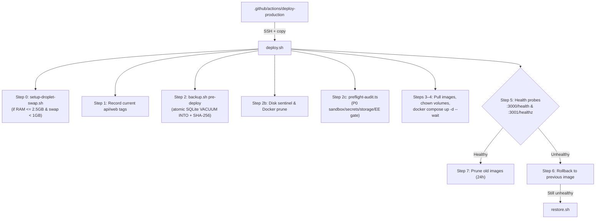

# `scripts/ops` — Production Operations, Deployment & Disaster Recovery

This directory contains host-level production rollout, security preflight, SQLite backup/restore, and VPS swap-provisioning scripts for running `modelscript.org` and `ansatz.social` via Docker Compose.

## Deployment & Rollback Lifecycle

## Quick Reference

| File                                               | Typical Invocation                                     | When to Use                                                                                                           |
| -------------------------------------------------- | ------------------------------------------------------ | --------------------------------------------------------------------------------------------------------------------- |
| [`deploy.sh`](./deploy.sh)                         | `IMAGE_TAG=<tag> bash scripts/ops/deploy.sh`           | Automated CD rollout on the production Docker host (invoked by `.github/actions/deploy-production`).                  |
| [`backup.sh`](./backup.sh)                         | `bash scripts/ops/backup.sh [label]`                   | Take an atomic SQLite snapshot of `modelscript.db` with SHA-256 checksum and optional S3 upload.                      |
| [`restore.sh`](./restore.sh)                       | `bash scripts/ops/restore.sh list \| latest \| <file>` | Inspect available snapshots or restore `modelscript.db` during disaster recovery / failed rollout.                    |
| [`preflight-audit.ts`](./preflight-audit.ts)       | `npm run preflight:prod`                               | Validate production security hardening (Bubblewrap sandbox, secrets, storage, Redis/proxy, EE license) before launch. |
| [`setup-droplet-swap.sh`](./setup-droplet-swap.sh) | `bash scripts/ops/setup-droplet-swap.sh [--force]`     | Idempotently provision a 2 GB swapfile + sysctl tuning on low-memory Linux VPS droplets.                              |

---

## Script Reference

### [`deploy.sh`](./deploy.sh)

- **Purpose:** End-to-end production rollout orchestrator for Docker Compose (`docker-compose.yml` + `docker-compose.prod.yml` + `.env.production`) with fail-closed pre-deploy backups, disk-space protection, security preflight gating, health probes, and automatic image + database rollback.
- **When to use:** Executed automatically over SSH by `.github/actions/deploy-production/action.yml` (called from `ci.yml` `deploy_production` and `release.yml`), or manually on the production host for emergency rollouts.
- **Environment variables:**
  - `IMAGE_TAG` (default `latest`): Container image tag to pull and deploy.
  - `DEPLOY_PROFILE` (default `flagship`): Docker Compose profile.
  - `TARGET_DIR` (default `/opt/modelscript`): Host deployment directory containing compose files, `.env.production`, and `backups/`.
- **Health checks:** Polls `http://127.0.0.1:3000/health`, `http://127.0.0.1:3001/healthz` (`Host: modelscript.org`), and `http://127.0.0.1:3001/healthz` (`Host: ansatz.social`) up to 15 attempts (2s interval).
- **Exit codes:** `0` on healthy rollout; `1` on backup failure, preflight failure, or rollout failure (after dumping container logs and attempting rollback).

---

### [`backup.sh`](./backup.sh)

- **Purpose:** Creates an atomic snapshot of the SQLite `modelscript.db` database with a `.sha256` sidecar and optional S3 offsite replication.
- **When to use:** Called automatically by `deploy.sh` (`pre-deploy`) and `restore.sh` (`pre-restore`), or manually / via cron on the host before maintenance.
- **How it works:**
  - **Hot backup:** When the `api` container is running, runs `PRAGMA wal_checkpoint(TRUNCATE)` and `VACUUM INTO` via `better-sqlite3` inside the container, then copies the snapshot to `${TARGET_DIR}/backups/`.
  - **Cold backup:** When `api` is stopped, copies `modelscript.db` (and `-wal` if present) directly from the `api-data` Docker volume mountpoint. Skips cleanly on fresh installs with no DB yet.
  - Uploads to `s3://${BACKUP_S3_BUCKET}/${BACKUP_S3_PREFIX}/` if `BACKUP_S3_BUCKET` is set, and prunes snapshots beyond `RETENTION_COUNT`.
- **Arguments & environment variables:**
  - Positional `$1`: Snapshot label (default `manual`, sanitized to `[a-zA-Z0-9_-]`, max 24 chars).
  - `TARGET_DIR` (`/opt/modelscript`), `RETENTION_COUNT` (`14`), `BACKUP_S3_BUCKET` (optional), `BACKUP_S3_PREFIX` (`database-backups`).
- **Outputs & exit codes:** Writes `${TARGET_DIR}/backups/snapshot-<label>-<UTC>.db` + `.sha256` and prints `BACKUP_FILE=<filename>`. Exits `0` on success/fresh install, `1` if snapshot is missing or empty.

---

### [`restore.sh`](./restore.sh)

- **Purpose:** Operator-facing and automated disaster-recovery tool to list or restore SQLite snapshots into the `api-data` Docker volume.
- **When to use:** Run `bash scripts/ops/restore.sh list` to inspect snapshots, or `bash scripts/ops/restore.sh latest` / `<filename>` to recover database state (also invoked automatically by `deploy.sh` if an image rollback remains unhealthy).
- **How it works:** Takes an emergency `pre-restore` backup first, stops the `api` container, replaces `modelscript.db` inside the volume mountpoint, removes stale `-wal`/`-shm` files, resets permissions (`chmod 644`, `chown 1000:1000`), restarts `api` with `up -d --wait`, and polls `/health`.
- **Arguments & environment variables:** `$1` = `list` (default) | `--list` | `-l` | `latest` | `<filename|path>`; `TARGET_DIR` (`/opt/modelscript`).
- **Exit codes:** `0` on `list` or healthy restore; `1` if snapshot/volume is missing or `api` fails healthcheck.

---

### [`preflight-audit.ts`](./preflight-audit.ts)

- **Purpose:** Pre-deployment security and infrastructure hardening gate across 5 categories (`sandbox`, `secrets`, `storage`, `network`, `compliance`).
- **When to use:** Run `npm run preflight:prod` before launching a production instance; also enforced automatically in `deploy.sh` Step 2c.
- **Checks performed:**
  - **P0 (blocking):** Bubblewrap (`bwrap --unshare-net`) rootless isolation works; `JWT_SECRET` is >= 32 chars and non-weak; `STRIPE_WEBHOOK_SECRET` starts with `whsec_` if `STRIPE_SECRET_KEY` is set; `STORAGE_DIR` (default `./data/libraries`) is writable; S3 credentials exist if `STORAGE_BACKEND=s3`; `MSX_LICENSE_KEY` is set if `MSX_EDITION=ee` and `MSX_LICENSE_ENFORCE=true`.
  - **P1 (warnings):** `AUDIT_HMAC_SECRET` >= 32 chars; `REDIS_URL` uses `redis:`/`rediss:`; `TRUST_PROXY=true` in production.
- **Exit codes:** `0` if all P0 checks pass, `1` if any P0 check fails.
- **Callers:** Root `package.json` (`preflight:prod`), `scripts/ops/deploy.sh`, and `.github/actions/deploy-production/action.yml`.

---

### [`setup-droplet-swap.sh`](./setup-droplet-swap.sh)

- **Purpose:** Idempotently creates and activates a Linux swapfile (default `2G` at `/swapfile`) with `/etc/fstab` persistence and `/etc/sysctl.d/99-modelscript-swap.conf` (`vm.swappiness=10`, `vm.vfs_cache_pressure=50`).
- **When to use:** Called automatically by `deploy.sh` Step 0 on small droplets (`RAM <= 2500 MB` and `swap < 1000 MB`), or manually on new VPS hosts with `--force` / `-f`.
- **Environment variables:** `SWAP_FILE` (default `/swapfile`), `SWAP_SIZE_GB` (default `2`).
- **Exit codes:** `0` on success or skip (already has `>= 1500 MB` swap or `> 4000 MB` RAM without `--force`); `1` on permission/command failure.
