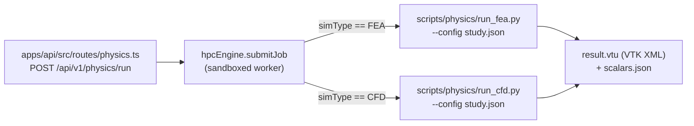

# `scripts/physics` — Lightweight Python Physics Solver Workers

This directory contains zero-dependency Python (stdlib-only) CFD and structural FEA solver worker scripts invoked by `@modelscript/api` (`POST /api/v1/physics/run`) when executing physics studies through `hpcEngine` from the repository root (including inside Docker `WORKDIR /app`).

## Architecture Role

> [!NOTE]
> These scripts are deliberately pure Python (no `gmsh`, `numpy`, or external solver binaries required) so the API can execute fast analytical CFD/FEA studies in constrained or sandboxed environments. For full external CAE containers, see `docker/cae/` (`solver-calculix`, `solver-su2`).

## Quick Reference

| File                         | Typical Invocation                                         | Domain & Outputs                                                                                              |
| ---------------------------- | ---------------------------------------------------------- | ------------------------------------------------------------------------------------------------------------- |
| [`run_cfd.py`](./run_cfd.py) | `python3 scripts/physics/run_cfd.py --config <study.json>` | 3D tetrahedral channel CFD study -> `result.vtu` (`Velocity`, `Pressure`) + `scalars.json`.                   |
| [`run_fea.py`](./run_fea.py) | `python3 scripts/physics/run_fea.py --config <study.json>` | 3D tetrahedral cantilever beam FEA study -> `result.vtu` (`Displacement`, `VonMisesStress`) + `scalars.json`. |

---

## Script Reference

### [`run_cfd.py`](./run_cfd.py)

- **Purpose:** Generates a structured 3D tetrahedral channel mesh (`8x4x4` grid -> 225 nodes, 640 `VTK_TETRA` cells over `0.5 x 0.2 x 0.2 m`) and computes an analytical parabolic boundary-layer / recirculation velocity field and linear pressure drop.
- **When to use:** Dispatched automatically by `apps/api/src/routes/physics.ts` for non-FEA physics studies, or run manually during API/visualizer testing.
- **CLI arguments:** `--config <path>` (required) — path to `study.json` containing `parameters.{inletVelocity, fluidDensity, kinematicViscosity, timeStep, endTime}`. Changes working directory to the parent of `study.json` and logs `geometry.step` size if present.
- **Outputs & exit codes:** Writes ASCII XML `result.vtu` (`PointData`: 3-component `Velocity`, scalar `Pressure`) and `scalars.json` (`maxVelocity`, `maxPressure`, `minPressure`, `pressureDrop`, `reynoldsNumber`, `status: "COMPLETED"`) into the study directory. Exits `0` on success.

---

### [`run_fea.py`](./run_fea.py)

- **Purpose:** Generates a structured 3D tetrahedral cantilever beam mesh (`5x3x3` grid -> 96 nodes, 225 `VTK_TETRA` cells over `0.1 x 0.05 x 0.02 m`) and computes analytical Euler-Bernoulli beam deflection and bending Von Mises stress.
- **When to use:** Dispatched automatically by `apps/api/src/routes/physics.ts` when `simType === "FEA"`, or run manually for VTU viewer testing.
- **CLI arguments:** `--config <path>` (required) — path to `study.json` containing `parameters.{youngsModulus, poissonsRatio, forceZ, materialDensity}`. Changes working directory to the parent of `study.json` and logs `geometry.step` size if present.
- **Outputs & exit codes:** Writes ASCII XML `result.vtu` (`PointData`: 3-component `Displacement`, scalar `VonMisesStress`) and `scalars.json` (`maxDisplacement`, `maxVonMisesStress`, `nodesCount`, `elementsCount`, `status: "COMPLETED"`) into the study directory. Exits `0` on success.
