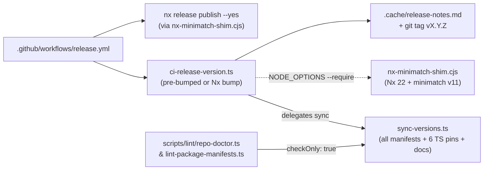

# `scripts/release` — Monorepo Versioning & Release Automation

This directory manages ModelScript's fixed-version monorepo release strategy (strict numeric `X.Y.Z` SemVer required by `@vscode/vsce` and desktop packagers), changelog synthesis, git tagging, and Nx release compatibility shims.

## Release Workflow Architecture

## Quick Reference

| File                                               | npm Script(s)                                           | When to Use                                                                                                                          |
| -------------------------------------------------- | ------------------------------------------------------- | ------------------------------------------------------------------------------------------------------------------------------------ |
| [`sync-versions.ts`](./sync-versions.ts)           | `sync:versions`, `version:bump`, `lint:versions`        | Synchronize or verify the single monorepo version across all packages, docs metadata, lockfiles, and hardcoded TS version constants. |
| [`ci-release-version.ts`](./ci-release-version.ts) | `release:dry-run` (and `.github/workflows/release.yml`) | Compute/finalize release version, update `CHANGELOG.md`, sync versions, commit, tag `vX.Y.Z`, and export `.cache/release-notes.md`.  |
| [`nx-minimatch-shim.cjs`](./nx-minimatch-shim.cjs) | Loaded by `release` (`NODE_OPTIONS='--require ...'`)    | Restores `minimatch.makeRe` removed in `minimatch` v11+ so Nx 22's `nx release` commands succeed.                                    |

---

## Script Reference

### [`sync-versions.ts`](./sync-versions.ts)

- **Purpose:** Enforces ModelScript's fixed-version monorepo strategy using `packages/runtime/package.json` as the canonical version source (or an explicit `X.Y.Z` / `patch` / `minor` / `major` bump).
- **When to use:**
  - Run `npm run lint:versions` (or `npm run lint:repo`) to verify no package or source constant has drifted.
  - Run `npm run version:bump -- patch` (or `minor` / `major` / `X.Y.Z`) or `npm run sync:versions` to propagate a version change everywhere.
- **Files synchronized:**
  1. Root `package.json` and all workspace `package.json` manifests discovered via `scripts/lib/workspaces.ts` (excluding `packages/examples*` and `apps/ide/github-fs`).
  2. `apps/desktop/src-tauri/tauri.conf.json` and `Cargo.toml` (when present).
  3. Built extension manifests (`dist/extension/package.json`, `apps/ide/dist/extension/package.json`) when present (write mode only).
  4. `package-lock.json` root and workspace entries (when present).
  5. `apps/docs/docs/.vitepress/theme/data/languages.generated.json`.
  6. Six embedded TypeScript version pins: `apps/web/src/config.ts` (`ANSATZ_VERSION`), `packages/mcp/src/main.ts` (`SERVER_VERSION`), `packages/dsl/src/codegen/ide/extension-generator.ts` (`workspaceVersion`), `apps/api/src/routes/admin.ts`, `apps/cli/src/main.ts`, and `apps/desktop/src/index.ts`.
- **CLI flags:** `--check` (exits `1` on mismatch without writing), `--version=<ver>` or positional `<X.Y.Z|patch|minor|major>`.
- **Callers:** Root `package.json` (`lint:versions`, `sync:versions`, `version:bump`), `ci-release-version.ts`, `scripts/lint/lint-package-manifests.ts`, `scripts/lint/repo-doctor.ts`, and `.github/workflows/release.yml`.

---

### [`ci-release-version.ts`](./ci-release-version.ts)

- **Purpose:** "Smart Hybrid" release version, changelog, and git tag orchestrator supporting both pre-bumped milestone PRs and release-time Conventional Commit bumps.
- **When to use:** Executed automatically by `.github/workflows/release.yml`, or locally via `npm run release:dry-run` to preview the next release version and release notes without mutating Git.
- **How it works:**
  - Compares `packages/runtime/package.json` against the latest `v[0-9]*` git tag.
  - **Pre-bumped path:** If `CHANGELOG.md` already has a `## <targetVersion>` section, stamps today's date `(YYYY-MM-DD)`, merges any new `feat`/`fix`/`perf` commits since the last changelog commit, runs `syncVersions()`, commits `chore(release): publish <ver>` if dirty, and force-tags `v<ver>`.
  - **Release-time bump path:** Invokes `npx nx release --skip-publish` (with `NODE_OPTIONS` preloading the minimatch shim), runs `syncVersions()`, commits/amends, and tags `v<ver>`.
  - Writes `.cache/release-notes.md` and exports `version` and `notes_file` to `$GITHUB_OUTPUT`.
- **CLI flags:** `--dry-run`, `--bump=<auto|current|patch|minor|major|pre*|X.Y.Z>` (or positional version argument).
- **Note:** In the release-time bump branch, verify that the `nx-minimatch-shim.cjs` preload path resolves to `scripts/release/nx-minimatch-shim.cjs` (not the pre-refactor `scripts/nx-minimatch-shim.cjs`).

---

### [`nx-minimatch-shim.cjs`](./nx-minimatch-shim.cjs)

- **Purpose:** CommonJS preload shim (`NODE_OPTIONS='--require ./scripts/release/nx-minimatch-shim.cjs'`) that monkey-patches `minimatch.makeRe` onto `minimatch` v11+ (enforced by root `pnpm.overrides`), restoring compatibility with Nx 22's `find-matching-projects.js` and `repository-git-tags.js`.
- **When to use:** Automatically loaded by `npm run release` and `.github/workflows/release.yml` (`nx release publish --yes`). Can be removed once Nx upgrades natively to `minimatch` v11+.
